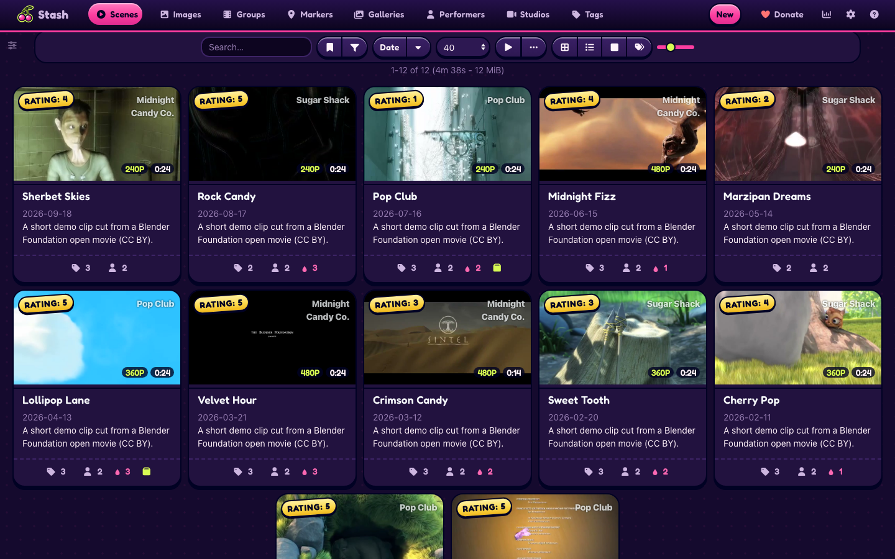
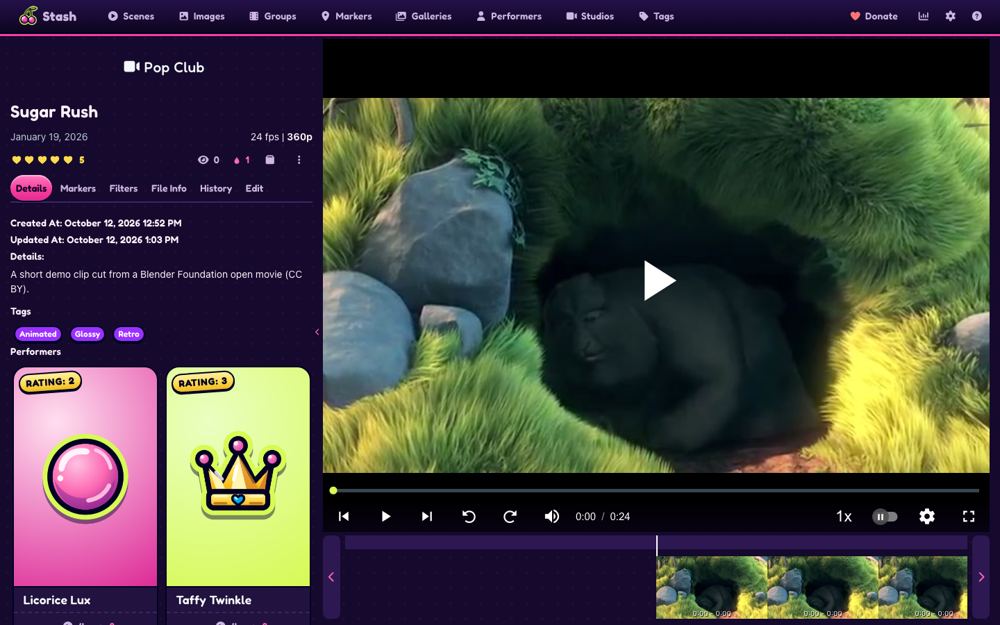
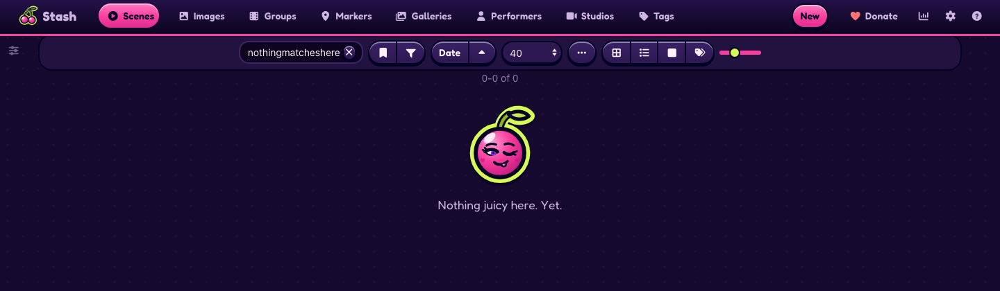
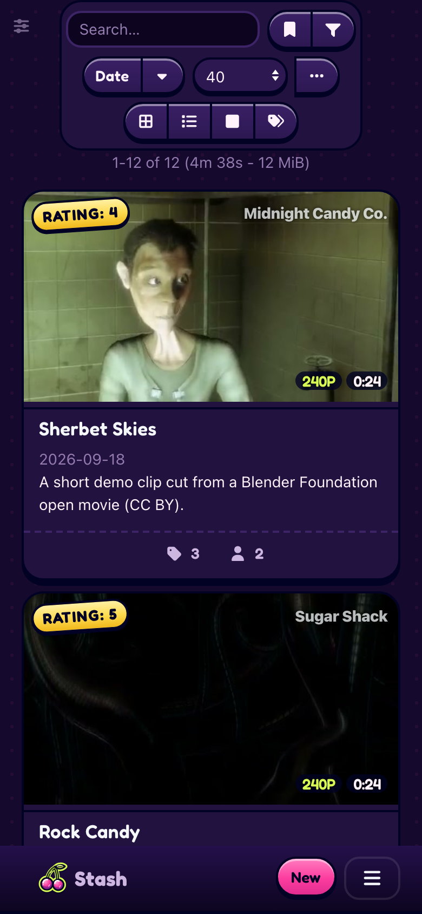

# Juicy

A pink, playful theme for [Stash](https://github.com/stashapp/stash), the self-hosted media organizer. Juicy installs as a Stash plugin, so you switch it on, off or update it from Settings > Plugins instead of pasting CSS into the Custom CSS box.

Juicy brings glossy candy stickers, gold hearts for ratings, a gum-bubble loader and a little cheek in the wording. Calm mode and Plain labels settings turn the motion and the copy down, and Stash's SFW mode keeps the candy and drops the cheek. The [live preview](https://candyboudoir.github.io/juicy/) shows every component on Stash's own markup, and the design rules are in [docs/design.md](docs/design.md). Juicy 0.1.0 is built and tested on Stash v0.31.1.



## Install

1. In Stash, open Settings > Plugins > Available Plugins and click Add source.
2. Fill in the source:
   - Name: `Juicy`
   - Source URL: `https://candyboudoir.github.io/juicy/index.yml`
   - Local path: `juicy`
3. Expand the Juicy source, tick Theme - Juicy and click Install.
4. Turn off any other theme plugin and clear any Custom CSS that restyles Stash, then refresh the page.

If you run a Stash develop build, use `https://candyboudoir.github.io/juicy/develop/index.yml` as the source URL instead. It carries fixes for upcoming Stash changes before they reach the stable channel. Add one of the two sources, never both: they carry the same plugin.

Stash lists new versions under Settings > Plugins > Installed Plugins when you click Check for updates. To remove Juicy, select it there and click Uninstall; Stash's own look returns on the next refresh.

## Settings

Juicy's settings sit with the plugin under Settings > Plugins. Both start off.

| Setting      | Effect                                                                 |
| ------------ | ---------------------------------------------------------------------- |
| Calm mode    | Turns off hover tilts, heart bursts and the bubble loader's animation. |
| Plain labels | Keeps Stash's own wording instead of Juicy's cheeky copy.              |


Juicy also follows your system's reduced-motion setting. In Stash's SFW content mode it keeps the colours, drops the cheeky copy and the drips, and shows a heart instead of the winking mascot.

Juicy makes no network requests beyond your own Stash server. Its font, Fredoka, ships inside the plugin.

## Screenshots

| Scene                                                       | Performers                                                   |
| ----------------------------------------------------------- | ------------------------------------------------------------ |
|  |       |
| **Performer**                                               | **An empty list**                                            |
|          |  |



The demo library uses invented names and short clips from Blender Foundation open movies: Big Buck Bunny (© 2008 Blender Foundation, www.bigbuckbunny.org) and Sintel (© Blender Foundation, durian.blender.org) under CC BY 3.0, and Elephants Dream (© 2006 Blender Foundation and Netherlands Media Art Institute, www.elephantsdream.org) under CC BY 2.5.

## Made with AI

Juicy was built with Claude, Anthropic's AI coding assistant, which wrote most of the CSS, JavaScript and SVG icons under the author's direction. The author set the design, reviewed the changes and tests each release on a real Stash library. Commits that Claude helped write carry a `Co-Authored-By: Claude` line.

## Development

Requires Node 22 and pnpm.

```bash
pnpm install
pnpm build          # dist/site: the plugin folder, its zip, index.yml and the design-system page
pnpm check          # prettier, eslint, stylelint
pnpm deploy:local   # build, copy the plugin into a Stash plugins folder over SSH and reload plugins
```

`deploy:local` reads `STASH_URL`, `STASH_SSH_HOST`, `STASH_PLUGIN_DIR` and, when Stash has a login, `STASH_API_KEY_FILE` from the environment. A gitignored `.envrc` is a good home for them.

- `src/Theme-Juicy.yml` is the plugin manifest.
- `src/css/` holds numbered partials that the build joins into one `juicy.css`.
- `src/js/juicy.js` adds the heart bursts, the cheeky copy and the settings.
- `src/icons/` holds the sticker and glyph SVGs.
- `design-system/` is the design-system page. It loads the built theme over Bootstrap 4.6, which stands in for Stash's own styles.

### Compatibility tests

The Compatibility workflow installs Juicy on each Stash version listed in `tests/stash-versions.json` and on the latest Stash develop build, every night and on every change. It checks that Stash still renders the elements Juicy styles and compares screenshots with baselines from the newest listed version. To run it against a local Stash:

```bash
pnpm build
tests/stash/stash.sh v0.31.1 stash-work        # or develop
tests/stash/media.sh stash-work/library
WORK=stash-work node tests/stash/prepare.mjs
pnpm test:compat contract
```

`main` is the trunk and feeds the develop channel; `prod` feeds the stable channel. Every push to either publishes both channels and the design-system page to GitHub Pages and checks the live files against the build. When `prod` carries a version with no tag yet, the Release workflow tags it and publishes a GitHub Release from that version's CHANGELOG section. Plugin zips are reproducible, so the release asset and the served zip share one sha256. Each Stash release changes some markup, so each one gets a pass over the design-system page and a check on a live library.

## License

MIT. Fredoka is bundled under the SIL Open Font License 1.1 (`assets/fonts/OFL.txt` in the plugin).
