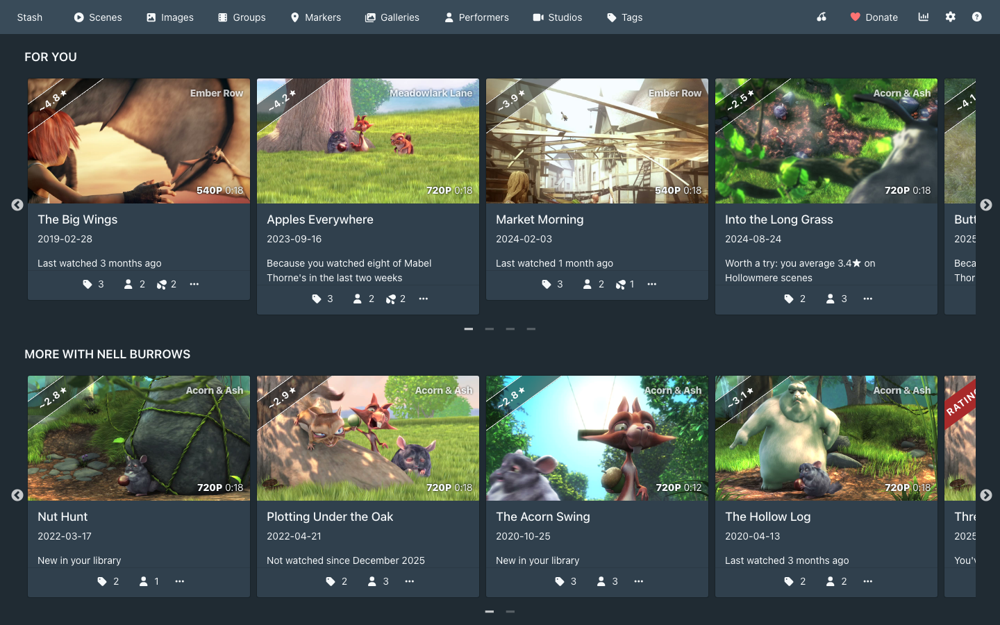
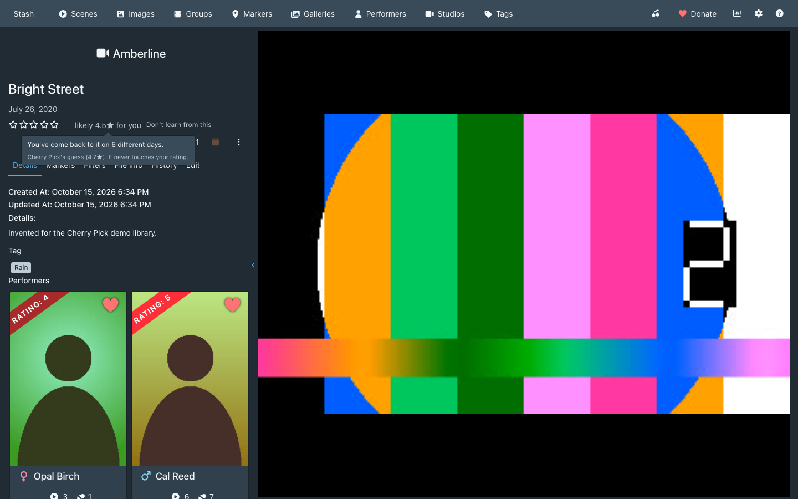
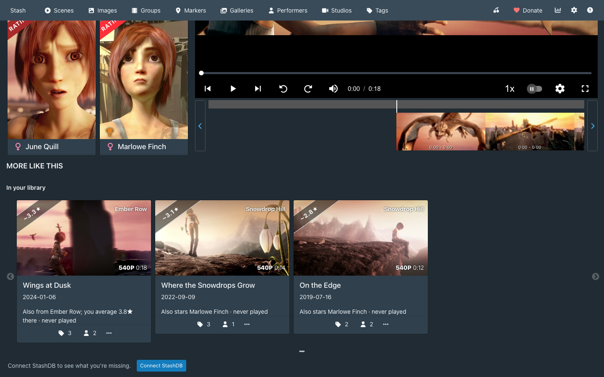
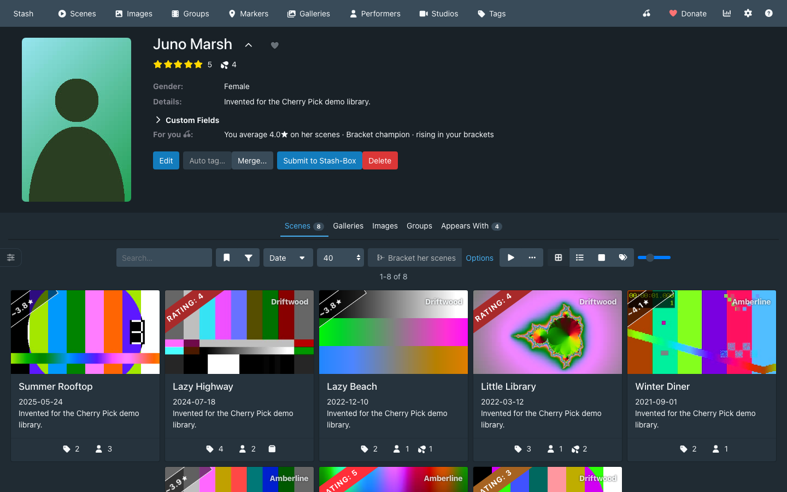
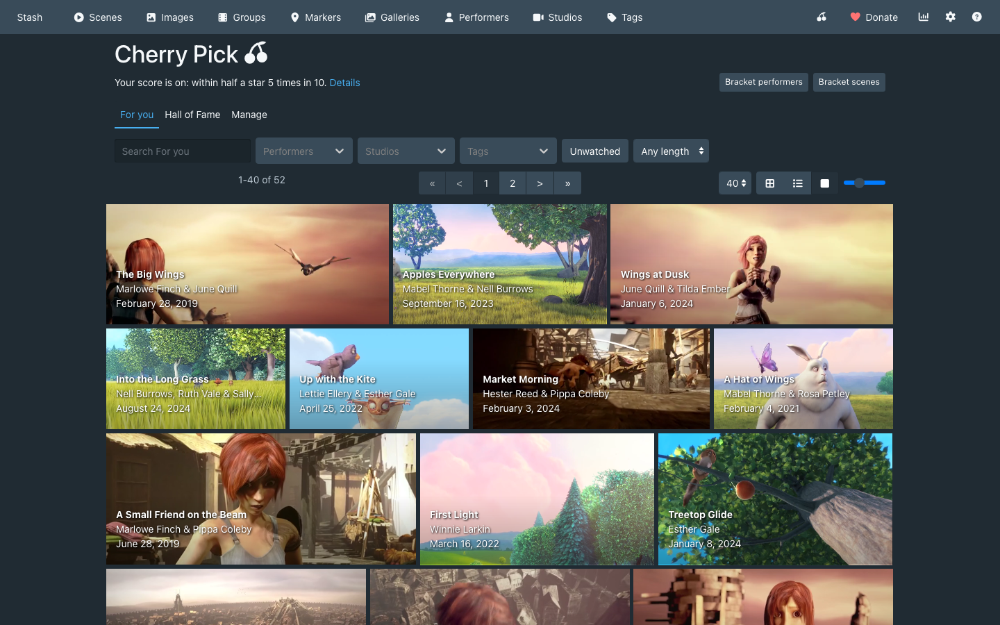
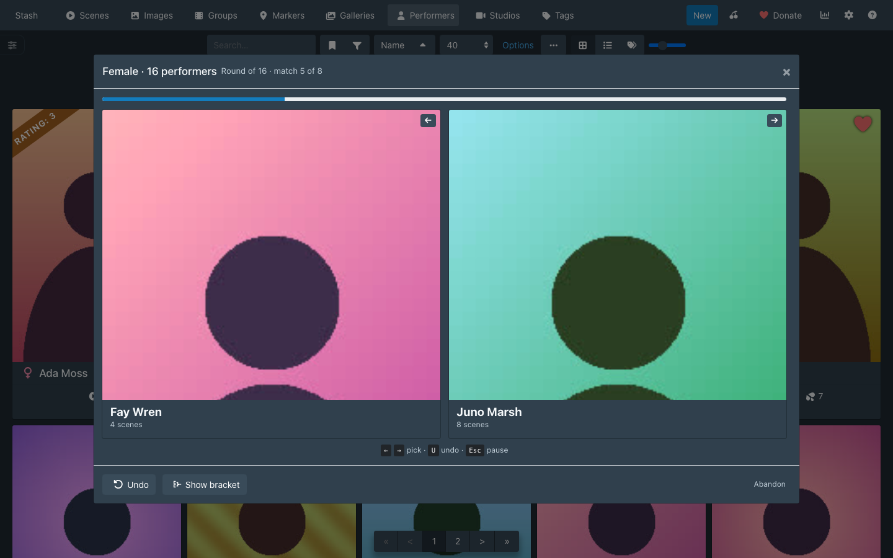
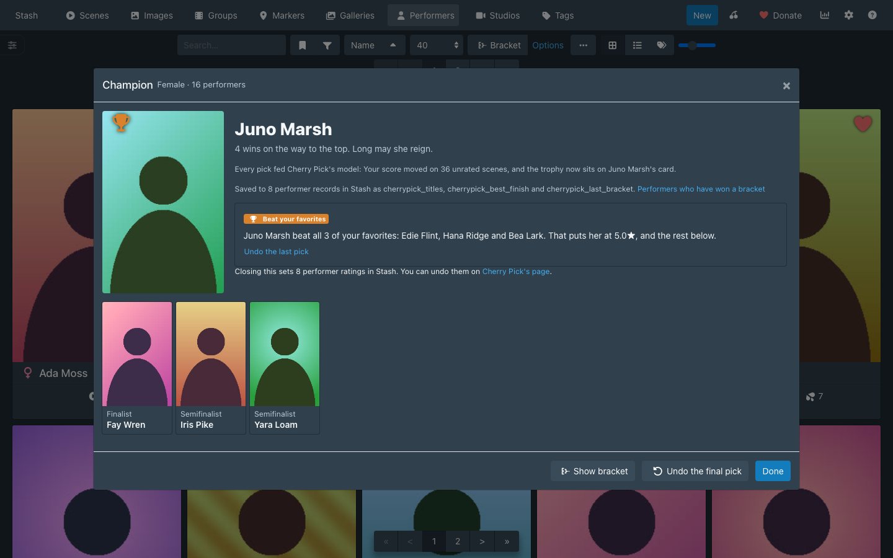
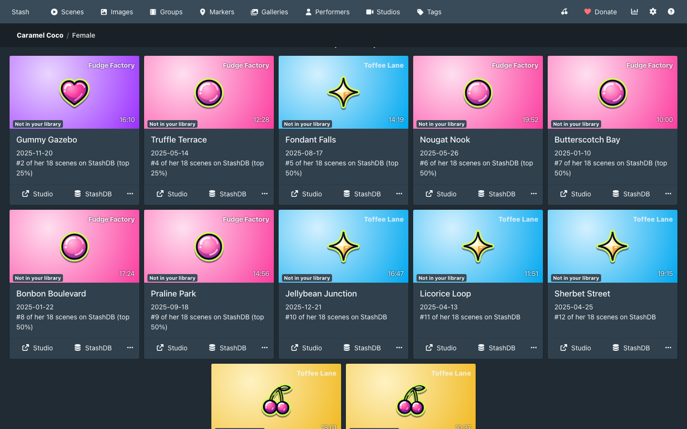
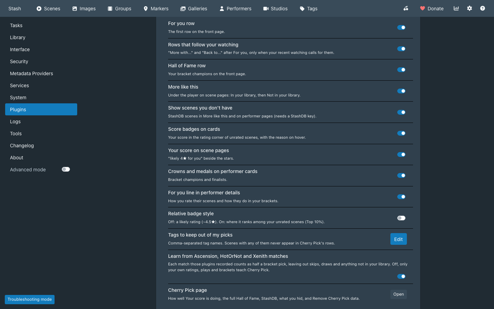
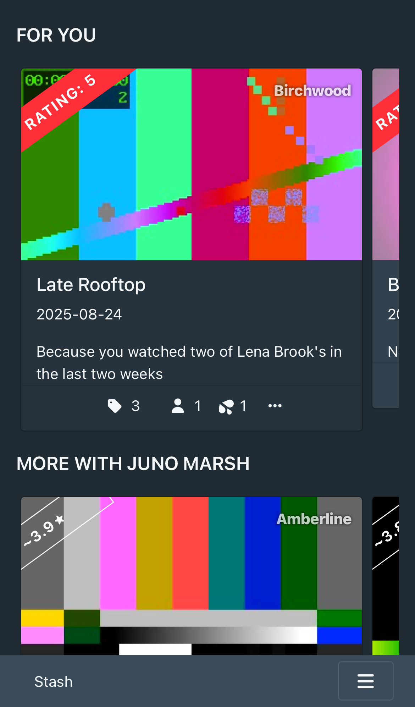

# Cherry Pick

A [Stash](https://github.com/stashapp/stash) plugin that learns what you like from your own ratings and plays, and shows it inside Stash's pages: a For you row on the front page, Your score on scenes you haven't rated, More like this on scene pages, and performer and scene brackets that sharpen what it learns. It needs no account and no setup. A StashDB key, if you have one in Stash, adds popularity and the scenes you don't have.

Cherry Pick 0.1.0 is built and tested on Stash v0.31.1.

## Install

Cherry Pick comes from the CandyBoudoir plugin source, which carries every CandyBoudoir plugin.

1. In Stash, open Settings > Plugins > Available Plugins and click Add source.
2. Fill in the source:
   - Name: `CandyBoudoir`
   - Source URL: `https://candyboudoir.github.io/index.yml`
   - Local path: `candyboudoir`
3. Expand the CandyBoudoir source, tick Cherry Pick and click Install, then refresh the page.

If you run a Stash develop build, use `https://candyboudoir.github.io/develop/index.yml` as the source URL instead. Add one of the two sources, never both: they carry the same plugins.

Cherry Pick works with any theme, including CandyBoudoir's Juicy and Leather: it uses Stash's own cards, rows, buttons and dialogs, and its CSS sets only layout.

## What it adds

Everything sits inside Stash's own pages. There is no new tab.

| Where                       | What                                                                                                                                                                                                                                                                                                                                                                                                                                                                             |
| --------------------------- | -------------------------------------------------------------------------------------------------------------------------------------------------------------------------------------------------------------------------------------------------------------------------------------------------------------------------------------------------------------------------------------------------------------------------------------------------------------------------------- |
| Front page                  | **For you** comes first: 12 scenes you own, ranked by your taste, what you have watched in the last two weeks, how long since you last played each one, and a little variety. Each card says why it is there. Up to two rows follow when your recent watching calls for them ("More with ...", "Back to ..."), then the **Hall of Fame** of your bracket champions, then Stash's own rows. The rows are worked out when you open the front page and hold still while it is open. |
| Scene cards                 | **Your score** in the rating corner of scenes you haven't rated ("~4.4★"), with the reason on hover.                                                                                                                                                                                                                                                                                                                                                                             |
| Scene page                  | "likely 4★ for you" beside the stars, with the reason, and **More like this** under the player: scenes in your library you have barely played, then, with a StashDB key, scenes you don't have.                                                                                                                                                                                                                                                                                  |
| Performer page              | A **For you** line in the details ("You average 4.9★ on her scenes · 3× champion"), and, with a StashDB key, their scenes you don't have after their scene list.                                                                                                                                                                                                                                                                                                                 |
| Performer cards             | A crown for bracket champions and a medal for finalists.                                                                                                                                                                                                                                                                                                                                                                                                                         |
| Performers and Scenes lists | **Bracket** and **Options**, beside the list's toolbar.                                                                                                                                                                                                                                                                                                                                                                                                                          |
| Navbar                      | A pair of cherries that opens Cherry Pick's page: how accurate Your score is, the full Hall of Fame, StashDB, what you have hidden, and Remove Cherry Pick data.                                                                                                                                                                                                                                                                                                                 |

Cards in Cherry Pick's rows have a menu with **Not interested**, which hides the card and shows less of what put it there, and **Don't learn from this**, which keeps a scene's plays, rating and bracket picks out of what Cherry Pick learns. Don't learn is also beside the stars on the scene page.

Nothing appears while a scene plays. Once you press play, every Cherry Pick piece on the page steps out until you leave it.

| Scene page                                                                         | More like this                                                                               |
| ---------------------------------------------------------------------------------- | -------------------------------------------------------------------------------------------- |
|  |  |
| **Performer page**                                                                 | **Cherry Pick's page**                                                                       |
|        |               |

### Your score

Your score is learned in your browser from your Stash ratings, from how you watch (how much of a scene you play, how often you come back to it, and its O count), and from your bracket picks. It shows only once it predicts your ratings better than your average rating does, which Cherry Pick checks on ratings it set aside. It is display only: it never changes your Stash ratings.

Your score needs 10 rated scenes before it can check itself. Until then, For you's header, the scene page beside the stars and Cherry Pick's page say how many ratings are left, and For you ranks by the performers you favorite or rate in Stash, your bracket picks and what you have played. The weight on favorites and performer ratings fades as your scene ratings arrive and is gone at 10.

### Brackets

Bracket on the Performers list starts a 16-performer, single-elimination bracket in one click, from the performers in your library with a photo and a scene, of your library's largest gender or the one the list is filtered to. Options picks the gender, 16, 32 or 64, and the pool (your library, favorites, or the list's current filter). When a gender's pool is short, Set genders lets you set missing genders in Stash with a tap; Cherry Pick never guesses one. Bracket on the Scenes list, or "Bracket her scenes" on a performer page, does the same with scenes you have watched.

Pick with a click, a tap or the arrow keys: U undoes, Esc pauses, and a paused bracket waits for you, even after a reload. Every pick teaches the model. When a performer bracket ends, the champion, finalist, semifinalists and quarterfinalists get three custom fields on their Stash record (`cherrypick_titles`, `cherrypick_best_finish`, `cherrypick_last_bracket`), which Stash shows on the performer page and can filter on. "Apply to my performer ratings" offers to rate them, with a preview and Undo; it changes nothing unless you ask. Four different champions of one gender unlock a Champions round.

| Playing                                                                   | The champion                                                                       |
| ------------------------------------------------------------------------- | ---------------------------------------------------------------------------------- |
|  |  |

### StashDB

With a StashDB key in Settings > Metadata Providers, Cherry Pick uses it straight away and also shows how widely a scene is held, a scene's rank among a performer's scenes, and the scenes you don't have. Without one, where those would show, a Connect StashDB button walks you through getting a key and adds it to Stash's settings for you. Cherry Pick's page can stop the lookups without removing the key.

### With Ascension, HotOrNot, Xenith or Restash

Ascension, HotOrNot and Xenith rank performers and scenes by Elo and keep the score in Stash's rating. Restash keeps a score in its own custom fields, and its "Also mirror score to rating100" setting writes that score over Stash's rating too. Cherry Pick reads a rating as yours only when none of these plugins set it. A record carrying Elo match history (the `hotornot_stats`, `elo_matches`, `performer_record`, `scene_record`, `xenith_stats` or `xenith_record` custom field) counts as unrated, and so does a record whose rating equals its `restash_score`. The random starting ratings Ascension's Prime tasks give unrated performers and scenes count as unrated too, and Cherry Pick recognises them by their shape: one value from 1 to 9 shared by most of them, one from 25 to 39, and 40. Your score, For you and the performer lines learn from the ratings you set yourself. A rating you set by hand that equals the record's Restash score reads as Restash's.

Apply never rates a performer or scene that Ascension, HotOrNot or Xenith ranks or whose rating is Restash's score, and its preview lists them as kept. When Ascension, HotOrNot or Xenith is installed, the preview says it will pick up every rating you apply, since its rankings start from Stash's ratings. Cherry Pick's custom fields sit beside theirs, and Remove Cherry Pick data removes only its own.

Learn from Ascension, HotOrNot and Xenith matches, under Settings > Plugins, teaches Cherry Pick from the games those plugins play. Ascension, HotOrNot_V3 and Xenith keep each performer's and scene's recent matches in a custom field (`performer_record`, `scene_record` or `xenith_record`), and Cherry Pick reads each won or lost match as a bracket pick at half the weight of one of yours, oldest first and ahead of your own picks. Skips, draws and opponents no longer in your library are left out, a match both players recorded counts once, and Don't learn from this keeps a scene's matches out as well. HotOrNot 1.0 and V2 keep only totals, so they add nothing. The switch starts on, and turning it off leaves their matches out. Cherry Pick's page counts the matches it learned from, and a reason names the plugin they came from: "Won 7 of 11 matches in Ascension".

## Settings

Settings > Plugins > Cherry Pick switches each piece on or off. All start on except Relative badge style.

| Setting                                           | Effect                                                                                      |
| ------------------------------------------------- | ------------------------------------------------------------------------------------------- |
| For you row                                       | The first row on the front page.                                                            |
| Rows that follow your watching                    | "More with ..." and "Back to ..." after For you.                                            |
| Hall of Fame row                                  | Your bracket champions on the front page.                                                   |
| More like this                                    | The rows under the player on scene pages.                                                   |
| Show scenes you don't have                        | StashDB scenes in More like this and on performer pages.                                    |
| Score badges on cards                             | Your score in the rating corner of unrated scenes.                                          |
| Your score on scene pages                         | "likely 4★ for you" beside the stars.                                                       |
| Crowns and medals on performer cards              | Bracket champions and finalists.                                                            |
| For you line in performer details                 | How you rate their scenes and how they do in your brackets.                                 |
| Relative badge style                              | Shows where a scene ranks among your unrated scenes ("Top 10%") instead of a likely rating. |
| Tags to keep out of my picks                      | Comma-separated tag names. Scenes with any of them never appear in Cherry Pick's rows.      |
| Learn from Ascension, HotOrNot and Xenith matches | Each match those plugins recorded counts as half a bracket pick.                            |

## Where your data lives

Cherry Pick runs in Stash's web interface and keeps its data in your Stash:

- **Stash's plugin configuration** (`config.yml`): the settings above, the Hall of Fame, a bracket in progress, Not interested, Don't learn, applied ratings and whether you turned StashDB off. A few kilobytes.
- **Your performers' custom fields**: the three bracket fields above, written once when a bracket ends.
- **Your Stash ratings**: only when you choose Apply to my performer ratings, never on a record another plugin ranks or whose rating Restash mirrors, and Undo puts them back.

Your browser keeps only what Cherry Pick can rebuild from Stash: a copy of your library for a fast start, the taste model, the StashDB cache and which For you cards you opened. A new browser rebuilds them.

### Network requests

- **Your Stash server**, through Stash's own GraphQL API: your library, the plugin configuration, and the custom fields and ratings above.
- **StashDB** (`https://stashdb.org/graphql`), only when Stash has a StashDB key, and never after you choose Stop using StashDB on Cherry Pick's page: the StashDB ids of the performers, scenes and studios on the pages you open, sent with your key in StashDB's `ApiKey` header, at most six requests per page, one a second. Answers are cached in your browser for 7 days. The covers of scenes you don't have load from StashDB's image server.

Cherry Pick sends nothing to CandyBoudoir or anyone else.

### Removing it

Cherry Pick's page has **Remove Cherry Pick data**: it clears the plugin configuration, removes the three custom fields from every performer and empties the browser cache. Ratings Cherry Pick applied stay, since they are your Stash ratings; undo them on the same page first if you want them gone. To remove the plugin itself, uninstall it in Settings > Plugins.

## Similar plugins

Other Stash plugins cover parts of this: Stash Curator and Binge recommend scenes, Missing Scenes lists scenes you don't have, and Stash Battle and HotOrNot rank by head-to-head picks. Cherry Pick puts these in Stash's own pages and feeds them into one model, with no server of its own.

The screenshots use an invented demo library with test-pattern covers and silhouettes.

## Made with AI

Cherry Pick was built with Claude, Anthropic's AI coding assistant, which wrote most of the code under the author's direction. The author set the design, iterated it on a mockup, and reviews the changes before each release. Commits that Claude helped write carry a `Co-Authored-By: Claude` line.

## Development

The repo's [README](../../README.md) covers building, testing and releasing. Cherry Pick's files:

- `src/CherryPick.yml` is the plugin manifest.
- `src/js/` holds ES modules and JSX that `plugin.mjs` bundles with esbuild into one `cherrypick.js`, compiled against Stash's own React. `model/` is the pure model (taste, For you, More like this, brackets), `runtime/` the store and Stash access, `storage/` the three places data lives, `features/` what each page gets, `ui/` the shared pieces.
- `src/css/` holds numbered partials, layout only.
- `docs/stash-seams.md` records where Cherry Pick hooks into Stash, checked against Stash's source.
- `tests/unit/` holds the model's unit tests, run by `pnpm test:unit`; `tests/demo-library.mjs` seeds the invented library the compatibility tests use.

## License

MIT, in the repo's [LICENSE](../../LICENSE).
