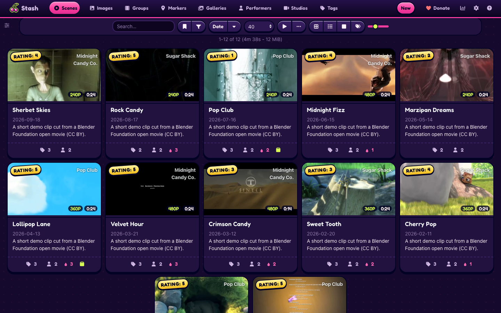
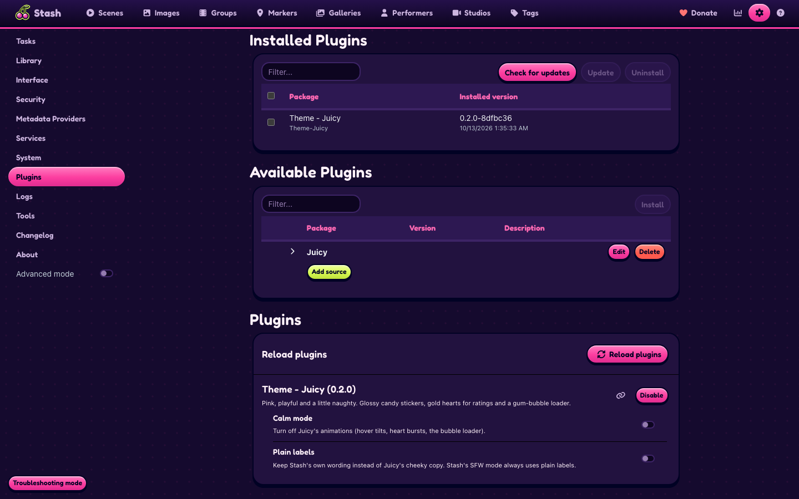
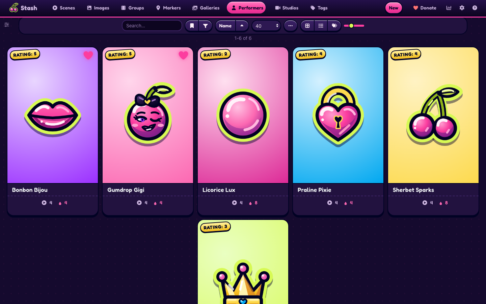
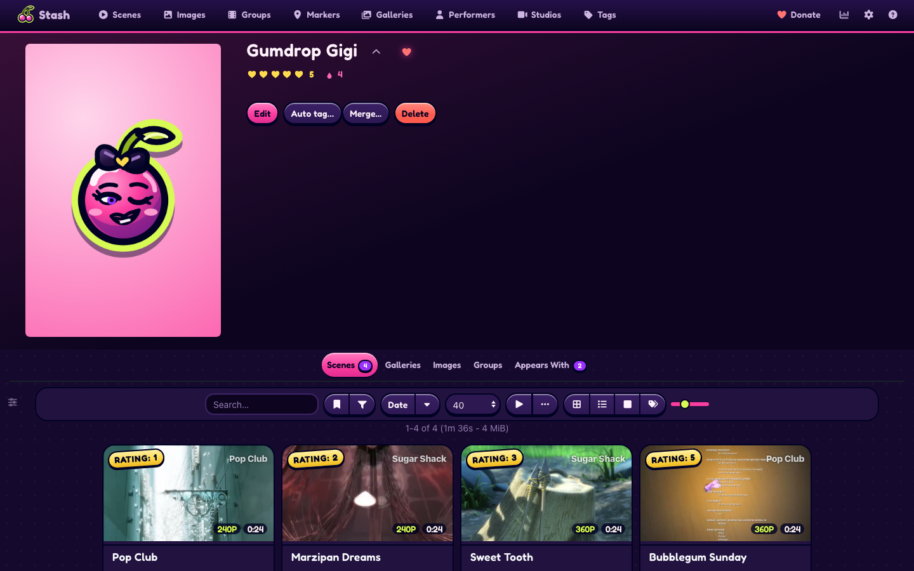
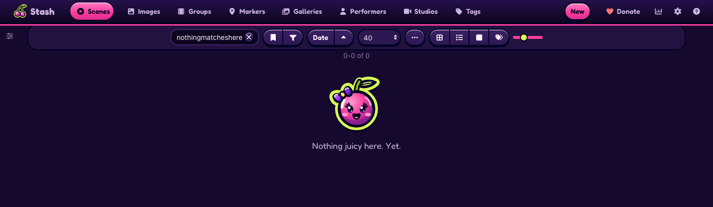

# Juicy

A pink, playful theme for [Stash](https://github.com/stashapp/stash), the self-hosted media organizer. Juicy installs as a Stash plugin, so you switch it on, off or update it from Settings > Plugins instead of pasting CSS into the Custom CSS box.

Juicy brings glossy candy stickers, gold hearts for ratings, a gum-bubble loader and a little cheek in the wording. Calm mode and Plain labels settings turn the motion and the copy down, and Stash's SFW mode keeps the candy and drops the cheek. The [live preview](https://candyboudoir.github.io/juicy/) shows every component on Stash's own markup, and the design rules are in [docs/design.md](docs/design.md). Juicy 0.5.4 is built and tested on Stash v0.31.1, including the Tagger and scrape screens that a stash-box such as StashDB adds.

## Install

Juicy comes from the CandyBoudoir plugin source, which carries every CandyBoudoir plugin.

1. In Stash, open Settings > Plugins > Available Plugins and click Add source.
2. Fill in the source:
   - Name: `CandyBoudoir`
   - Source URL: `https://candyboudoir.github.io/index.yml`
   - Local path: `candyboudoir`
3. Expand the CandyBoudoir source, tick Theme - Juicy and click Install.
4. Turn off any other theme plugin and clear any Custom CSS that restyles Stash, then refresh the page.

If you run a Stash develop build, use `https://candyboudoir.github.io/develop/index.yml` as the source URL instead. It carries fixes for upcoming Stash changes before they reach the stable channel. Add one of the two sources, never both: they carry the same plugins.

Stash lists new versions under Settings > Plugins > Installed Plugins when you click Check for updates. To remove Juicy, select it there and click Uninstall; Stash's own look returns on the next refresh.

Juicy installed from its first source, `https://candyboudoir.github.io/juicy/index.yml`, keeps getting updates from there. To move it to the CandyBoudoir source, uninstall Juicy, add the CandyBoudoir source and install Juicy again. Stash loads only one copy of a plugin, so a second install beside the first does not load.

## Settings

Juicy's settings sit with the plugin under Settings > Plugins. All of them start off, and each restyle setting shows only while its plugin is installed and on.

| Setting                    | Effect                                                                                  |
| -------------------------- | --------------------------------------------------------------------------------------- |
| Calm mode                  | Turns off hover tilts, heart bursts and the bubble loader's animation.                  |
| Plain labels               | Keeps Stash's own wording instead of Juicy's cheeky copy.                               |
| Restyle Insights           | Puts the Insights plugin's dashboard on the Stats page in Juicy's candy too.            |
| Restyle Performers Toolkit | Puts the Performers Toolkit plugin's page and performer-page tabs in Juicy's candy too. |

Juicy also follows your system's reduced-motion setting. In Stash's SFW content mode it keeps the colours, drops the cheeky copy and the drips, and shows a heart instead of the mascot.

### Insights and Performers Toolkit

[Insights](https://gitlab.com/allisless0/stash-plugins) (a stats dashboard on Stash's Stats page) and Performers Toolkit (a page at `/performerstoolkit`, and a strip and Stats and Catalog tabs on each performer's page) come from another author's suite of plugins. From Insights 2.12 and Performers Toolkit 0.13, each picks up its colours from the page, so it already matches Juicy's. With Restyle Insights or Restyle Performers Toolkit on, Juicy gives that plugin its candy: plum sticker cards on the polka dots, their names in Fredoka, candy tabs filled with each tab's colour, glossy pink and plum buttons, deep plum fields, pink chips and switches for the chosen option, cyan links, Juicy's ink and lime tooltips, and a plum toast with its kind on the left edge. Each tab's colour comes from Juicy's palette, and O's are bubblegum, as on the O counter. Turn both on to keep the two alike. Insights' heatmaps and its codec and resolution colours take Juicy's palette too. Each setting takes effect on the next page you open. Off, each keeps the colours it picks up, except that Insights' sidebar sticks below Juicy's pink rule and the count on Performers Toolkit's Catalog tab stays white like the other tabs' counts. Juicy is tested with Insights 2.13.0 and Performers Toolkit 0.19.0.

Juicy reads its own settings from your Stash on each page, and keeps the two restyle settings in your browser so those pages never open in their own colours first. It makes no other requests and none beyond your own Stash server. Its font, Fredoka, ships inside the plugin.

## Screenshots

| Scene                                                       | Performers                                                   |
| ----------------------------------------------------------- | ------------------------------------------------------------ |
|  |       |
| **Performer**                                               | **An empty list**                                            |
|          |  |

The demo library uses invented names and short clips from Blender Foundation open movies: Big Buck Bunny (© 2008 Blender Foundation, www.bigbuckbunny.org) and Sintel (© Blender Foundation, durian.blender.org) under CC BY 3.0, and Elephants Dream (© 2006 Blender Foundation and Netherlands Media Art Institute, www.elephantsdream.org) under CC BY 2.5.

## Made with AI

Juicy was built with Claude, Anthropic's AI coding assistant, which wrote most of the CSS, JavaScript and SVG icons under the author's direction. The author set the design, reviewed the changes and tests each release on a real Stash library. Commits that Claude helped write carry a `Co-Authored-By: Claude` line.

## Development

The repo's [README](../../README.md) covers building, testing and releasing. Juicy's files:

- `src/Theme-Juicy.yml` is the plugin manifest.
- `src/css/` holds numbered partials that the build joins into one `juicy.css`.
- `src/js/juicy.js` adds the heart bursts, the cheeky copy and the settings.
- `src/icons/` holds the sticker and glyph SVGs.
- `design-system/` is the design-system page, published at `/juicy/`. It loads the built theme over Bootstrap 4.6, which stands in for Stash's own styles.
- `tests/` holds Juicy's compatibility checks and screenshot baselines.
- `plugin.mjs` tells the shared build what goes into the plugin folder.

## License

MIT, in the repo's [LICENSE](../../LICENSE). Fredoka is bundled under the SIL Open Font License 1.1 (`assets/fonts/OFL.txt` in the plugin).
