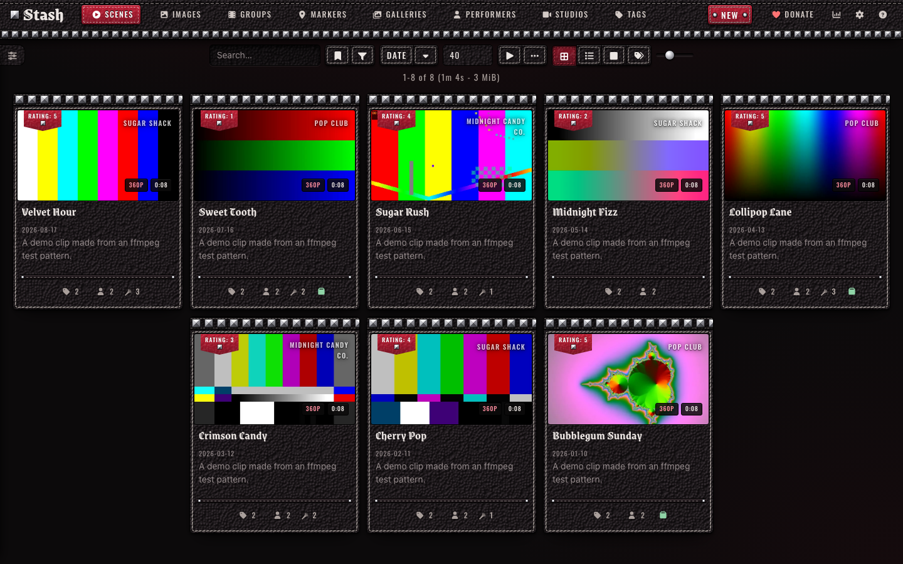
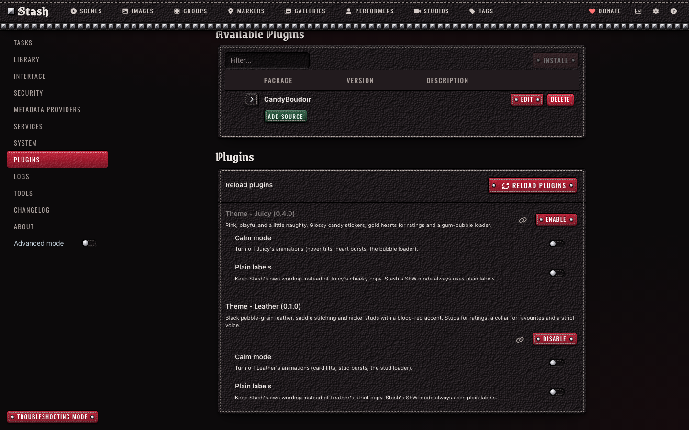
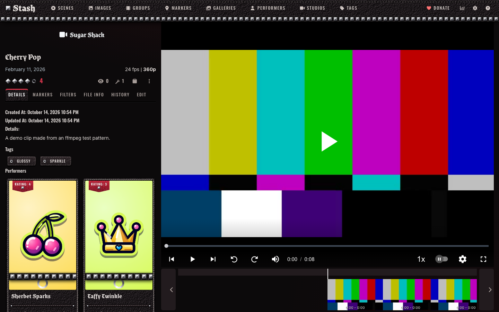
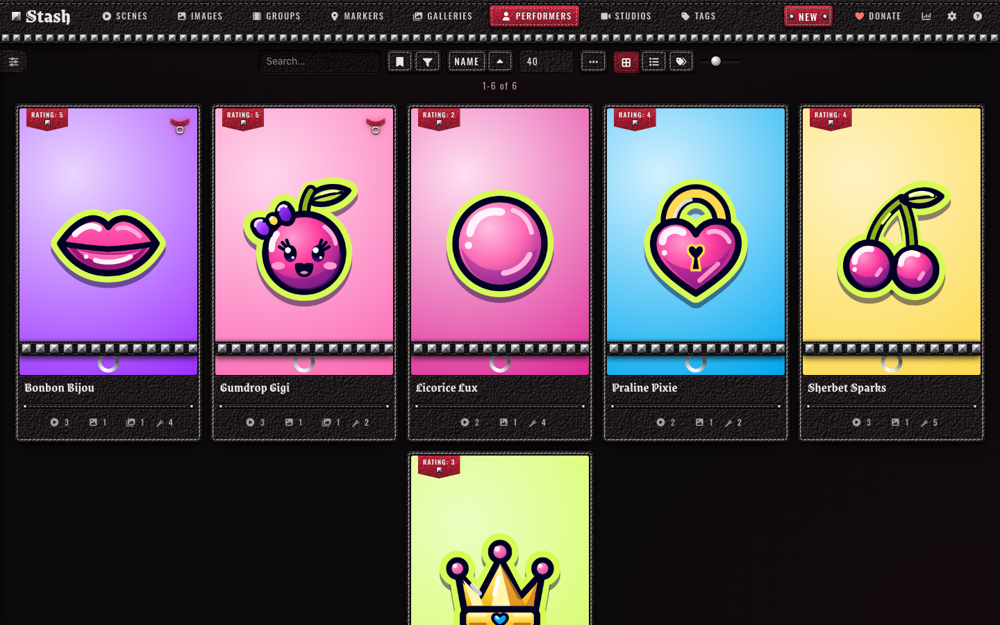
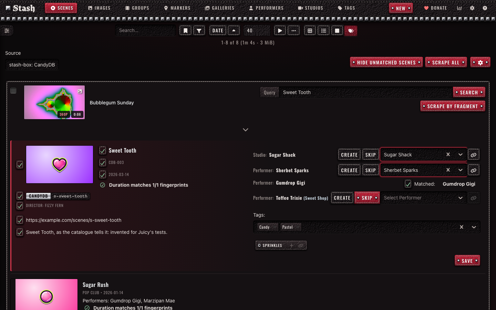
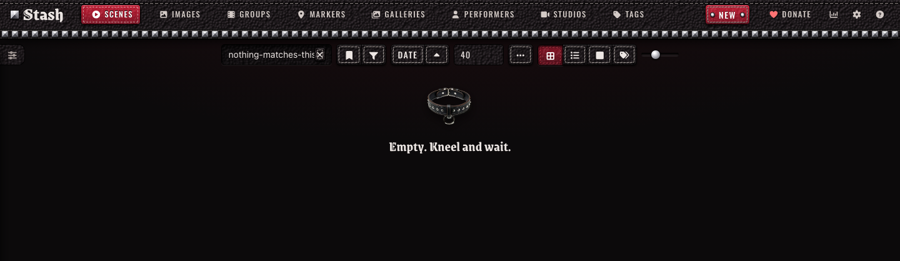
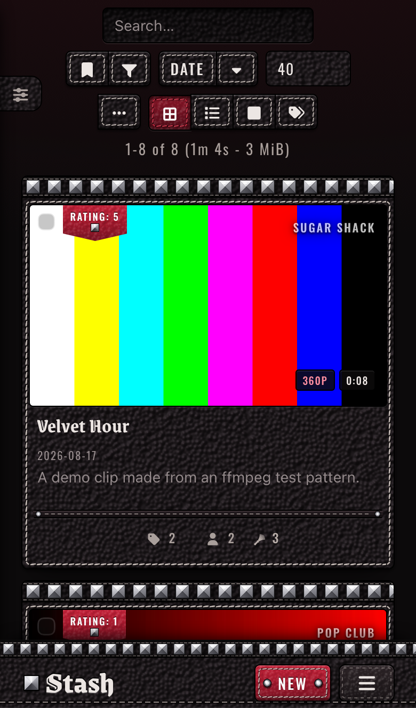

# Leather

A black leather theme for [Stash](https://github.com/stashapp/stash), the self-hosted media organizer. Leather installs as a Stash plugin, so you switch it on, off or update it from Settings > Plugins instead of pasting CSS into the Custom CSS box.

Leather dresses Stash in black pebble-grain leather with saddle stitching, nickel pyramid studs and a blood-red accent. Ratings are studs, the favourite is a collar, the O counter is a flogger, titles are set in blackletter, and a short list of Stash's messages speaks in a strict voice. Calm mode and Plain labels settings turn the motion and the copy down, and Stash's SFW mode keeps the leather and drops the collars and the voice. The [live preview](https://candyboudoir.github.io/leather/) shows every component on Stash's own markup, and the design rules are in [docs/design.md](docs/design.md). Leather 0.1.0 is built and tested on Stash v0.31.1, including the Tagger and scrape screens that a stash-box such as StashDB adds.

## Install

Leather comes from the CandyBoudoir plugin source, which carries every CandyBoudoir plugin.

1. In Stash, open Settings > Plugins > Available Plugins and click Add source.
2. Fill in the source:
   - Name: `CandyBoudoir`
   - Source URL: `https://candyboudoir.github.io/index.yml`
   - Local path: `candyboudoir`
3. Expand the CandyBoudoir source, tick Theme - Leather and click Install.
4. Turn off any other theme plugin, Juicy included, and clear any Custom CSS that restyles Stash, then refresh the page.

If you run a Stash develop build, use `https://candyboudoir.github.io/develop/index.yml` as the source URL instead. It carries fixes for upcoming Stash changes before they reach the stable channel, and plugins that have no stable release yet. Add one of the two sources, never both: they carry the same plugins.

Stash lists new versions under Settings > Plugins > Installed Plugins when you click Check for updates. To remove Leather, select it there and click Uninstall; Stash's own look returns on the next refresh.

## Settings

Leather's settings sit with the plugin under Settings > Plugins. Both start off.

| Setting      | Effect                                                             |
| ------------ | ------------------------------------------------------------------ |
| Calm mode    | Turns off card lifts, stud bursts and the stud loader's animation. |
| Plain labels | Keeps Stash's own wording instead of Leather's strict copy.        |

Leather also follows your system's reduced-motion setting. In Stash's SFW content mode it keeps the leather and the studs, drops the strict copy and the red sparks, takes the collar off performer cards, turns the favourite into a stud, and shows an O-ring on an empty list.

Leather makes no network requests beyond your own Stash server. Its fonts, Grenze Gotisch and Oswald, ship inside the plugin. The plugin is about 1.8 MB, most of it the leather texture at three screen densities; your browser downloads only the one that matches your screen.

## Screenshots

| Scene                                                       | Performers                                                   |
| ----------------------------------------------------------- | ------------------------------------------------------------ |
|  |       |
| **The Tagger**                                              | **An empty list**                                            |
|             |  |

The demo library uses invented names, clips and stills made from ffmpeg test patterns, and Juicy's stickers as performer portraits.

## Made with AI

Leather was built with Claude, Anthropic's AI coding assistant, which wrote most of the CSS, JavaScript and SVG glyphs under the author's direction. The leather textures come from `tools/leather.py`, and the gear on the design-system page was rendered locally with Qwen-Image 2512 (Apache 2.0) and cut out with `tools/cutout.py`. The author set the design and reviews the changes before each release. Commits that Claude helped write carry a `Co-Authored-By: Claude` line.

## Development

The repo's [README](../../README.md) covers building, testing and releasing. Leather's files:

- `src/Theme-Leather.yml` is the plugin manifest.
- `src/css/` holds numbered partials that the build joins into one `leather.css`.
- `src/js/leather.js` adds the stud bursts, the strict copy and the settings.
- `src/icons/` holds the glyph and strip SVGs, the leather and grain tiles and the collar.
- `design-system/` is the design-system page, published at `/leather/`. It loads the built theme over Bootstrap 4.6, which stands in for Stash's own styles, and keeps the large gear renders the plugin does not ship.
- `tools/` holds the scripts that made the textures and cut out the gear.
- `tests/` holds Leather's compatibility checks and screenshot baselines.
- `plugin.mjs` tells the shared build what goes into the plugin folder.

## License

MIT, in the repo's [LICENSE](../../LICENSE). Grenze Gotisch and Oswald are bundled under the SIL Open Font License 1.1 (`assets/fonts/grenze-gotisch/OFL.txt` and `assets/fonts/oswald/OFL.txt` in the plugin).
