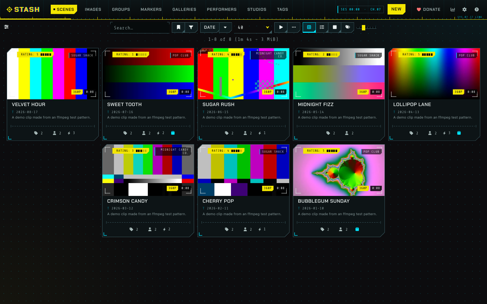
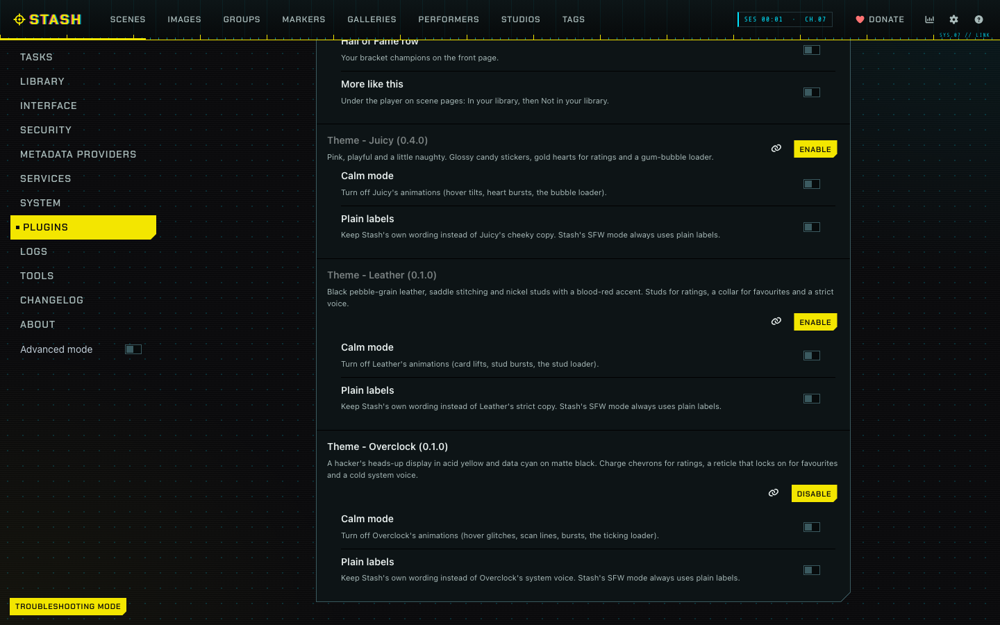
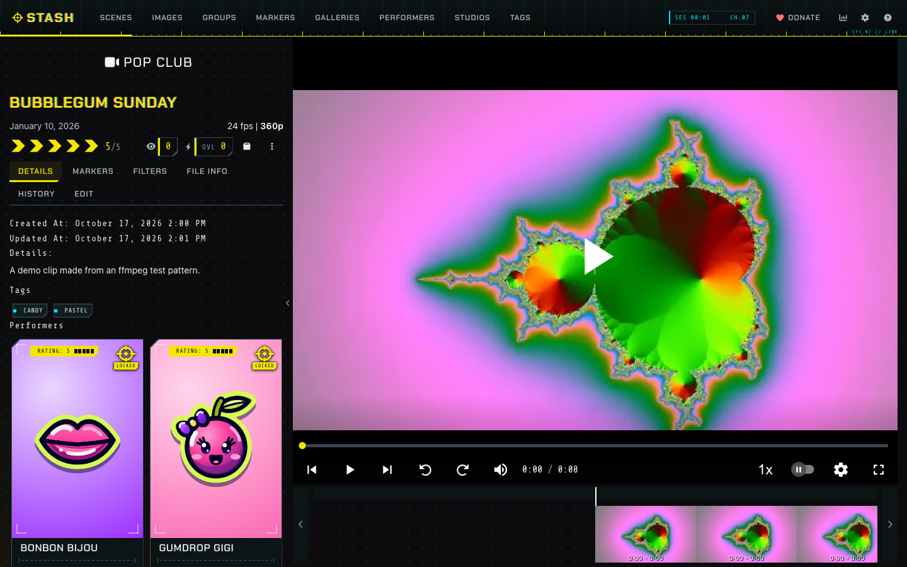
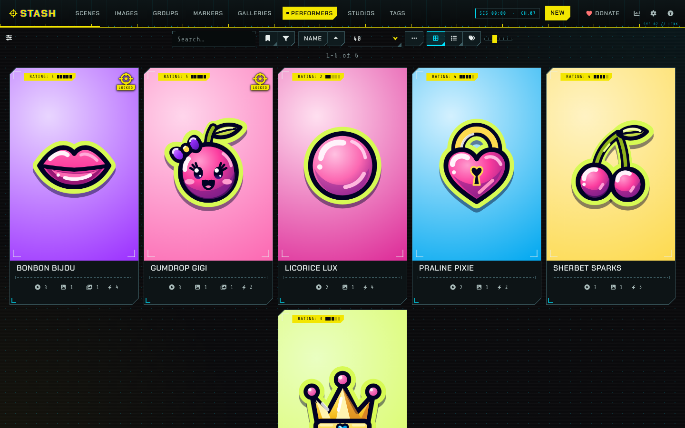
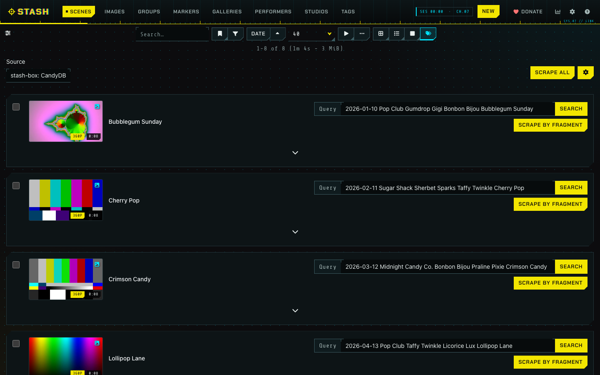
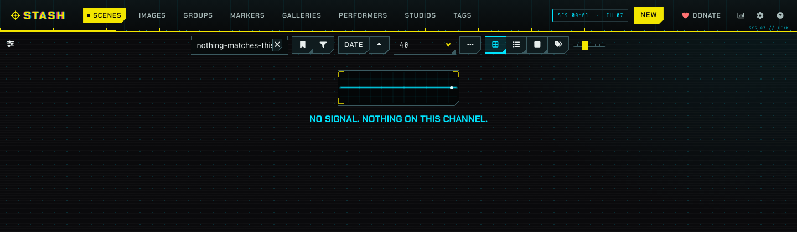
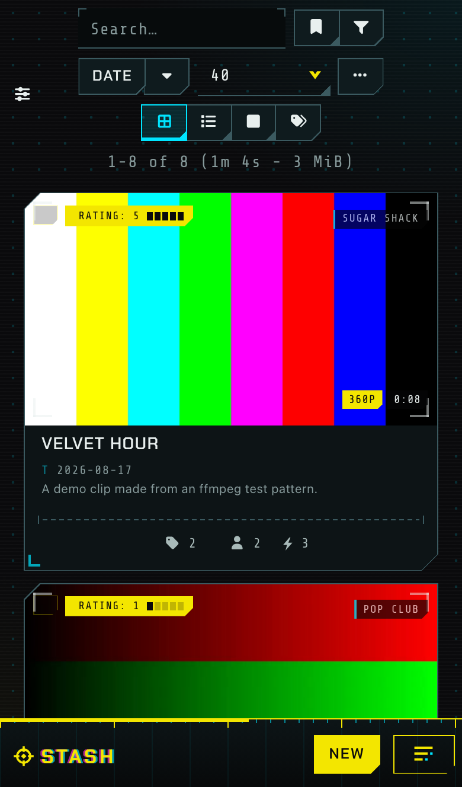

# Overclock

A heads-up display theme for [Stash](https://github.com/stashapp/stash), the self-hosted media organizer. Overclock installs as a Stash plugin, so you switch it on, off or update it from Settings > Plugins instead of pasting CSS into the Custom CSS box.

Overclock turns Stash into the heads-up display of a hacker's control rig: matte black with a faint dot grid and a scanline, teal-black panels with clipped corners and frame brackets, hex readouts, tick marks and hazard stripes, in acid yellow and data cyan. Ratings are charge chevrons, the favourite is a targeting reticle that locks on, the O counter is an overload bolt, and hovering a button or a card glitches it for a moment. A short list of Stash's messages speaks in the cold voice of the system running the session. Calm mode and Plain labels settings turn the motion and the copy down, and Stash's SFW mode keeps the display and drops the voice. The [live preview](https://candyboudoir.github.io/overclock/) shows every component on Stash's own markup, and the design rules are in [docs/design.md](docs/design.md). Overclock 0.1.0 is built and tested on Stash v0.31.1, including the Tagger and scrape screens that a stash-box such as StashDB adds.

## Install

Overclock comes from the CandyBoudoir plugin source, which carries every CandyBoudoir plugin.

1. In Stash, open Settings > Plugins > Available Plugins and click Add source.
2. Fill in the source:
   - Name: `CandyBoudoir`
   - Source URL: `https://candyboudoir.github.io/index.yml`
   - Local path: `candyboudoir`
3. Expand the CandyBoudoir source, tick Theme - Overclock and click Install.
4. Turn off any other theme plugin, Juicy and Leather included, and clear any Custom CSS that restyles Stash, then refresh the page.

If you run a Stash develop build, use `https://candyboudoir.github.io/develop/index.yml` as the source URL instead. It carries fixes for upcoming Stash changes before they reach the stable channel, and plugins that have no stable release yet. Add one of the two sources, never both: they carry the same plugins.

Stash lists new versions under Settings > Plugins > Installed Plugins when you click Check for updates. To remove Overclock, select it there and click Uninstall; Stash's own look returns on the next refresh.

## Settings

Overclock's settings sit with the plugin under Settings > Plugins. Both start off.

| Setting      | Effect                                                                           |
| ------------ | -------------------------------------------------------------------------------- |
| Calm mode    | Turns off the hover glitches, the scan lines, the bursts and the ticking loader. |
| Plain labels | Keeps Stash's own wording instead of Overclock's system voice.                   |

Overclock also follows your system's reduced-motion setting. In Stash's SFW content mode it keeps the display, drops the system voice and the red from the bursts, and shows the dead scope without a line on an empty list.

Overclock makes no network requests beyond your own Stash server. Its fonts, Chakra Petch and Share Tech Mono, ship inside the plugin, which is about 100 KB.

## Screenshots

| Scene                                                       | Performers                                                                     |
| ----------------------------------------------------------- | ------------------------------------------------------------------------------ |
|  |                         |
| **The Tagger**                                              | **An empty list**                                                              |
|             |  |

The demo library uses invented names, clips made from ffmpeg test patterns and drawn sticker art for its pictures.

## Made with AI

Overclock was built with Claude, Anthropic's AI coding assistant, which wrote most of the CSS, JavaScript and SVG motifs under the author's direction. The author set the design and reviews the changes before each release. Commits that Claude helped write carry a `Co-Authored-By: Claude` line.

## Development

The repo's [README](../../README.md) covers building, testing and releasing. Overclock's files:

- `src/Theme-Overclock.yml` is the plugin manifest.
- `src/css/` holds numbered partials that the build joins into one `overclock.css`.
- `src/js/overclock.js` adds the bursts, the system voice and the settings.
- `src/icons/` holds the glyph masks, the flat scope trace for empty lists and the hex dump behind the loader.
- `design-system/` is the design-system page, published at `/overclock/`. It loads the built theme over Bootstrap 4.6, which stands in for Stash's own styles, and keeps the motifs the plugin does not ship.
- `tests/` holds Overclock's compatibility checks and screenshot baselines.
- `plugin.mjs` tells the shared build what goes into the plugin folder.

## License

MIT, in the repo's [LICENSE](../../LICENSE). Chakra Petch and Share Tech Mono are bundled under the SIL Open Font License 1.1 (`assets/fonts/chakra-petch/OFL.txt` and `assets/fonts/share-tech-mono/OFL.txt` in the plugin).
