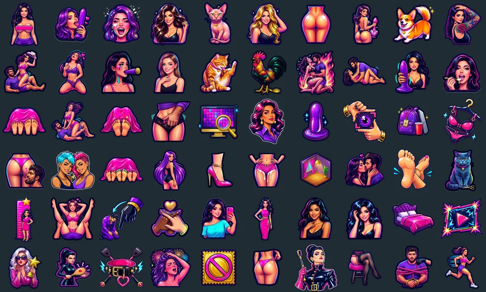

# Tag Candy

> Tag Candy's icons label tags in Stash, a self-hosted organizer for adult media libraries, and depict sexual themes in a cartoon sticker style for adults 18 or older. Every figure is drawn as an adult, and tags whose subject or picture is child-related get no icon. The plugin holds no nude images: its icons show no nipples, genitals or penetration.

Glossy sticker icons for the tags in [Stash](https://github.com/stashapp/stash), the self-hosted media organizer. Tag Candy matches each tag in your library to an icon by its StashDB link or its name, and Stash downloads the icon and sets it as the tag's image. Out of the box it fills tags that have no image and leaves every image you set alone. New, renamed and merged tags get their icon as they appear. The [icon gallery](https://candyboudoir.github.io/tagcandy/) shows every icon on the background Stash shows tags on.



## Install

Tag Candy comes from the CandyBoudoir plugin source, which carries every CandyBoudoir plugin.

1. In Stash, open Settings > Plugins > Available Plugins and click Add source.
2. Fill in the source:
   - Name: `CandyBoudoir`
   - Source URL: `https://candyboudoir.github.io/index.yml`
   - Local path: `candyboudoir`
3. Expand the CandyBoudoir source, tick Tag Candy and click Install.
4. Open Settings > Tasks, find Tag Candy under Plugin Tasks, and run Dry run to see what it would do, then Apply icons.

If you run a Stash develop build, use `https://candyboudoir.github.io/develop/index.yml` as the source URL instead. Add one of the two sources, never both: they carry the same plugins.

Tag Candy needs Stash v0.31.0 or later, which gave tags the custom fields it keeps track with. Nothing else needs installing: Stash runs Tag Candy's script itself, in the Docker images and in the Windows, macOS and Linux apps alike. The plugin is about 160 KB, because the icons stay on candyboudoir.github.io. When Tag Candy sets an icon, your Stash downloads it from there, about 45 KB a tag, so Stash needs internet access while it runs, and GitHub sees the address of the Stash that asks, as it does when you install a plugin.

## Tasks

| Task                    | What it does                                                                                                                  |
| ----------------------- | ----------------------------------------------------------------------------------------------------------------------------- |
| Apply icons             | Gives every matching tag its icon, and updates the icons Tag Candy set when a new version redraws them. Your own images stay. |
| Dry run                 | Reports what Apply icons would do with your current settings and lists the tags that match nothing. It changes nothing.       |
| Replace my own images   | Does what Apply icons does, and also swaps the images you set for icons, after copying each to a backup tag.                  |
| Restore replaced images | Puts back the images that Replace my own images swapped out, on tags that still hold Tag Candy's icon.                        |
| Delete backups          | Deletes the Tag Candy backups tags once you are happy with a swap.                                                            |
| Remove Tag Candy icons  | Clears every icon Tag Candy set and leaves every other image.                                                                 |

Each run ends with a line in Settings > Logs that counts the tags it gave an icon, updated, found current, left alone or could not match.

## How tags are matched

Tag Candy checks each tag in this order and stops at the first answer.

1. **Extra matches**, the `tag=concept` pairs in Settings, for names Tag Candy does not know or reads differently.
2. **The tag's StashDB link.** Stash links the tags it creates from StashDB, and the Tags tagger links the ones you made. A linked tag gets its StashDB tag's icon, or no icon until that one is drawn, whatever its name says, because StashDB files some narrower terms as aliases of broader tags.
3. **The tag's name, then each alias.** Case, punctuation and accents make no difference, and "&" reads as "and", so `Stockings & Garters` and `stockings and garters` match alike.

If Dry run lists tags of yours that match nothing and should, open an issue with the list, and the next version can learn them.

## Your own images

Tag Candy never replaces an image you set unless you ask it to. When it sets an icon it also writes a `tag_candy` custom field on the tag with the icon's name and the time, and an image counts as Tag Candy's only while the tag is unchanged since. Once you edit the tag, by uploading an image, renaming it or adding an alias, the image counts as yours, so Tag Candy stops updating that icon. A Tag Candy icon you copy onto a tag by hand counts as yours too. If you remove an icon Tag Candy set, it stays removed.

To swap your own images for icons as well, run Replace my own images. Only that task does this; Apply icons and the hooks never replace an image. Before each swap Tag Candy copies your image onto a backup tag named `Tag Candy backup <id>` under a parent tag, Tag Candy backups. Restore replaced images puts each one back, unless you have chosen another image since, and Delete backups removes the backup tags when you no longer need them.

Stash copies the image from its own address, so on a Stash with a password this needs an API key. Generate one in Settings > Security; Tag Candy reads it from Stash's settings and never creates one itself. Without a key, Replace my own images changes nothing and says so in the log.

## Settings

Tag Candy's settings sit with the plugin under Settings > Plugins.

| Setting                          | Default | Effect                                                                                                                           |
| -------------------------------- | ------- | -------------------------------------------------------------------------------------------------------------------------------- |
| Leave new and renamed tags alone | Off     | Stops the hooks that give new, renamed and merged tags their icon. Apply icons still works.                                      |
| Extra matches                    | Empty   | `tag=concept` pairs separated by semicolons, such as `Nylons=Stockings / Hosiery`. The concept is an icon's name in the gallery. |
| Icon overrides URL               | Empty   | Where your own pictures are served, if you keep any. See below.                                                                  |

## Icon overrides

Tag Candy ships no nude images. If you keep pictures of your own, nude versions or anything else, Icon overrides URL points Tag Candy at them, and each matching tag shows your picture instead of the regular icon. Tag Candy asks the address for every concept, including concepts with no icon yet, and a concept with no file there keeps its regular icon. Clearing the setting and running Apply icons puts the regular icons back.

Each file is named after its concept: lowercase, `&` as `and`, accents dropped and everything else between words a hyphen, with `.webp` on the end. `Big Dick` is `big-dick.webp` and `Stockings / Hosiery` is `stockings-hosiery.webp`, the regular icon's file name without its hash. With the setting filled in, Dry run lists the file each of your tags asks for. Dry run cannot see which files the address holds, so Apply icons is what finds out. When you replace or delete a file, the next Apply icons updates its tags.

The setting takes a web address, such as `https://example.org/tag-icons/`, or a path that your own Stash serves. The address must answer 404 for a file it does not have, as Stash, GitHub Pages, nginx and Caddy do. To serve a folder from Stash, add it to `custom_served_folders` in Stash's `config.yml` and restart Stash:

```yaml
custom_served_folders:
  /tag-candy-overrides: /root/.stash/tag-candy-overrides
```

then set Icon overrides URL to `/custom/tag-candy-overrides/`. The folder stays behind Stash's login, so on a Stash with a password this also needs an API key.

## Uninstall

Run Remove Tag Candy icons first, so the icons and their `tag_candy` fields go, then uninstall Tag Candy under Settings > Plugins > Installed Plugins. Uninstalling alone leaves the icons on your tags as ordinary images.
