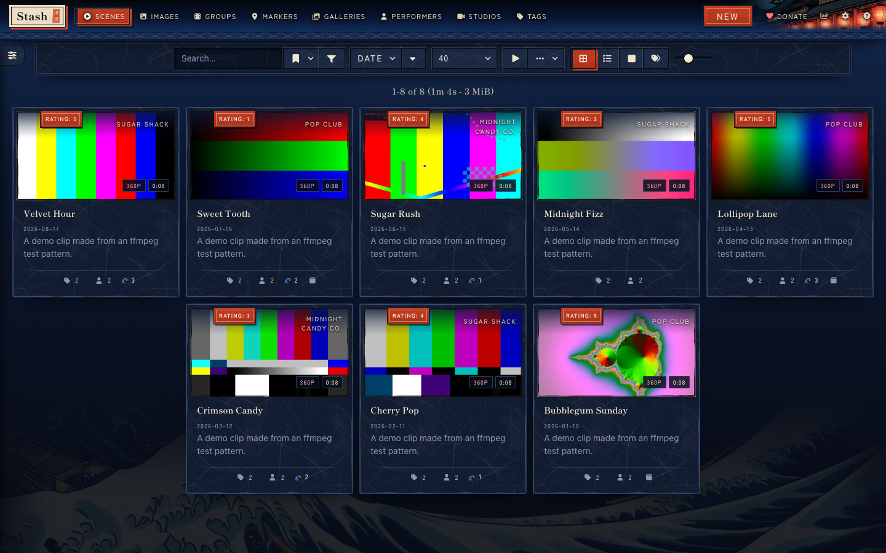
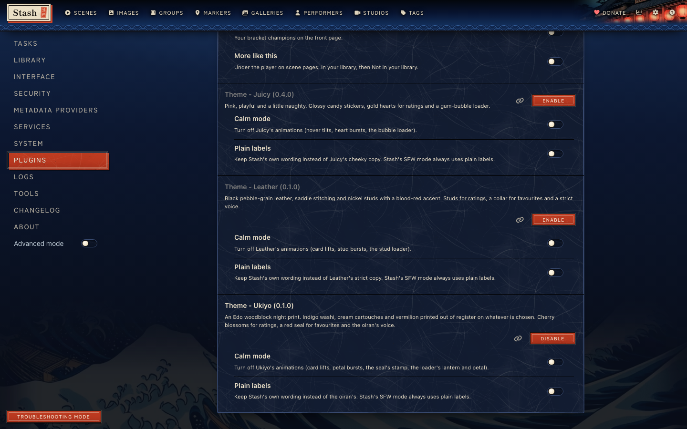
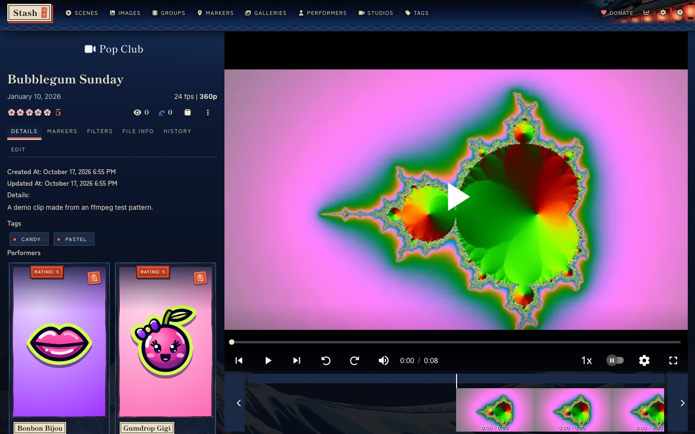
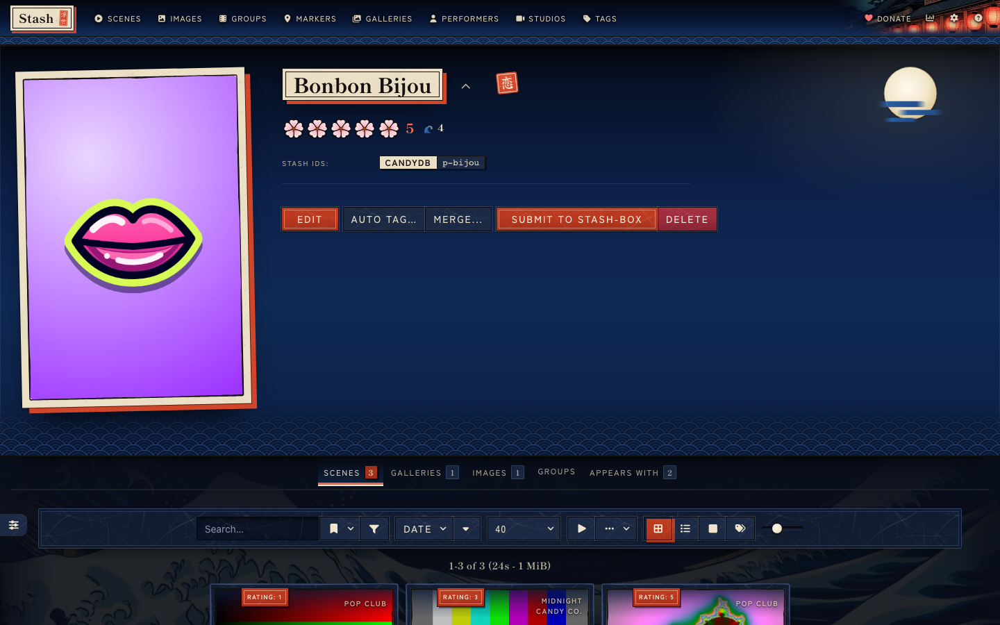
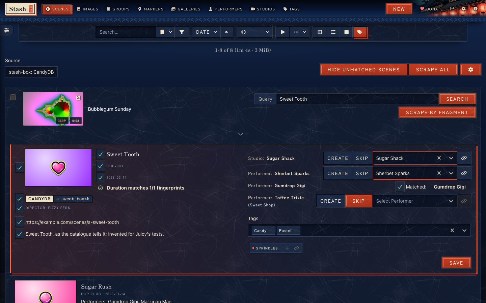
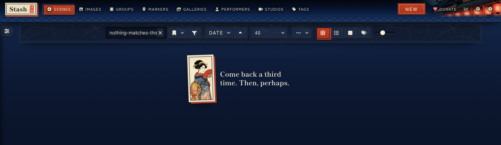
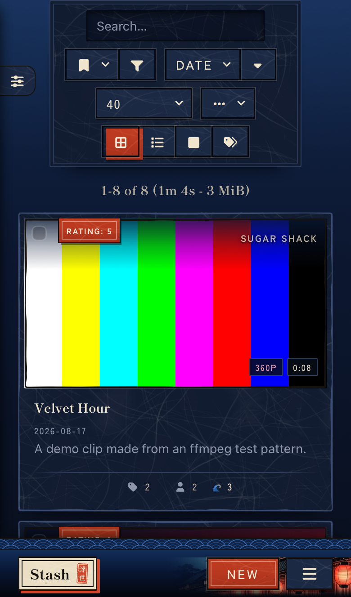

# Ukiyo

An Edo woodblock night print theme for [Stash](https://github.com/stashapp/stash), the self-hosted media organizer. Ukiyo installs as a Stash plugin, so you switch it on, off or update it from Settings > Plugins instead of pasting CSS into the Custom CSS box.

Ukiyo dresses Stash as an ukiyo-e night print: a Prussian-blue sky graded to black, indigo washi paper, cream cartouches with sumi keylines and vermilion for whatever is chosen, printed a little out of register. Ratings are cherry blossoms, the favourite is a red seal carved with 恋 (koi, romantic love), the O counter is a breaking wave, and a short list of Stash's messages speaks in the voice of an oiran, a courtesan of Edo's Yoshiwara, taken from the quarter's real customs. Calm mode and Plain labels settings turn the motion and the copy down, and Stash's SFW mode keeps the print and drops the voice and the beauty print. The [live preview](https://candyboudoir.github.io/ukiyo/) shows every component on Stash's own markup, and the design rules are in [docs/design.md](docs/design.md). Ukiyo 0.1.0 is built and tested on Stash v0.31.1, including the Tagger and scrape screens that a stash-box such as StashDB adds.

## Install

Ukiyo comes from the CandyBoudoir plugin source, which carries every CandyBoudoir plugin.

1. In Stash, open Settings > Plugins > Available Plugins and click Add source.
2. Fill in the source:
   - Name: `CandyBoudoir`
   - Source URL: `https://candyboudoir.github.io/index.yml`
   - Local path: `candyboudoir`
3. Expand the CandyBoudoir source, tick Theme - Ukiyo and click Install.
4. Turn off any other theme plugin and clear any Custom CSS that restyles Stash, then refresh the page.

If you run a Stash develop build, use `https://candyboudoir.github.io/develop/index.yml` as the source URL instead. It carries fixes for upcoming Stash changes before they reach the stable channel, and plugins that have no stable release yet. Add one of the two sources, never both: they carry the same plugins.

Stash lists new versions under Settings > Plugins > Installed Plugins when you click Check for updates. To remove Ukiyo, select it there and click Uninstall; Stash's own look returns on the next refresh.

## Settings

Ukiyo's settings sit with the plugin under Settings > Plugins. Both start off.

| Setting      | Effect                                                                                          |
| ------------ | ----------------------------------------------------------------------------------------------- |
| Calm mode    | Turns off card lifts, petal bursts, the seal's stamp and the loader's lantern, petal and glint. |
| Plain labels | Keeps Stash's own wording instead of the oiran's, and drops the beauty print on empty lists.    |

Ukiyo also follows your system's reduced-motion setting. In Stash's SFW content mode it keeps the print, the blossoms, the seal and the wave, drops the oiran's copy and never shows the beauty print. Stash's own Enable background image setting (Settings > Interface > Detail Page) still decides whether her picture shows behind the performer header, as a faint tone in the night sky.

Ukiyo makes no network requests beyond your own Stash server. Its fonts, Shippori Mincho B1 and Zen Kaku Gothic New, ship inside the plugin, Latin only: the two Japanese words it prints, 浮世 and 恋, are carved into its seals as outlines. The plugin is about 0.6 MB, most of it the washi tile at three screen densities, the sea along the page foot and the beauty print; your browser downloads only the tile that matches your screen.

## Screenshots

| Scene                                                       | Performer                                                                       |
| ----------------------------------------------------------- | ------------------------------------------------------------------------------- |
|  |  |
| **The Tagger**                                              | **An empty list**                                                               |
|             |               |

The demo library uses invented names and clips made from ffmpeg test patterns, with soft colour stand-ins for its pictures.

## Made with AI

Ukiyo was built with Claude, Anthropic's AI coding assistant, which wrote most of the CSS, JavaScript and SVG motifs under the author's direction. The washi tile, the patterns, the keylines and the motifs come from the scripts in `tools/`. The night print and the beauty print were rendered locally with Qwen-Image 2512 (Apache 2.0) and cropped with `tools/crops.py`. The kanji on the seals are outlines drawn from Yuji Syuku by Kinuta Font Factory (SIL OFL 1.1). The author set the design and reviews the changes before each release. Commits that Claude helped write carry a `Co-Authored-By: Claude` line.

## Development

The repo's [README](../../README.md) covers building, testing and releasing. Ukiyo's files:

- `src/Theme-Ukiyo.yml` is the plugin manifest.
- `src/css/` holds numbered partials that the build joins into one `ukiyo.css`.
- `src/js/ukiyo.js` adds the petal bursts, the oiran's copy and the settings.
- `src/icons/` holds the motif, glyph and pattern SVGs, the washi tile and the crops of the two prints.
- `design-system/` is the design-system page, published at `/ukiyo/`. It loads the built theme over Bootstrap 4.6, which stands in for Stash's own styles, and keeps the whole night print and the motifs the plugin does not ship.
- `tools/` holds the scripts that made the washi, the patterns, the motifs and the crops, and the kanji outlines the seals use.
- `tests/` holds Ukiyo's compatibility checks and screenshot baselines.
- `plugin.mjs` tells the shared build what goes into the plugin folder.

## License

MIT, in the repo's [LICENSE](../../LICENSE). Shippori Mincho B1 and Zen Kaku Gothic New are bundled under the SIL Open Font License 1.1 (`assets/fonts/shippori-mincho-b1/OFL.txt` and `assets/fonts/zen-kaku-gothic-new/OFL.txt` in the plugin). The Yuji Syuku outlines in `tools/kanji.json` are under the same license (`tools/kanji-OFL.txt`).
